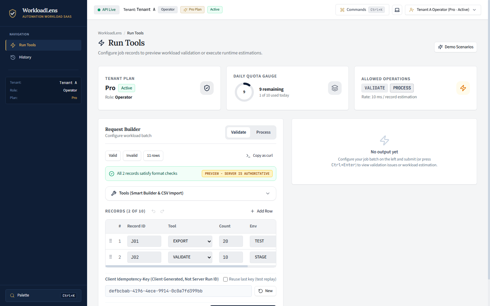
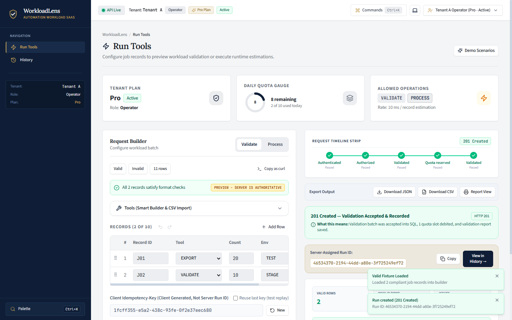
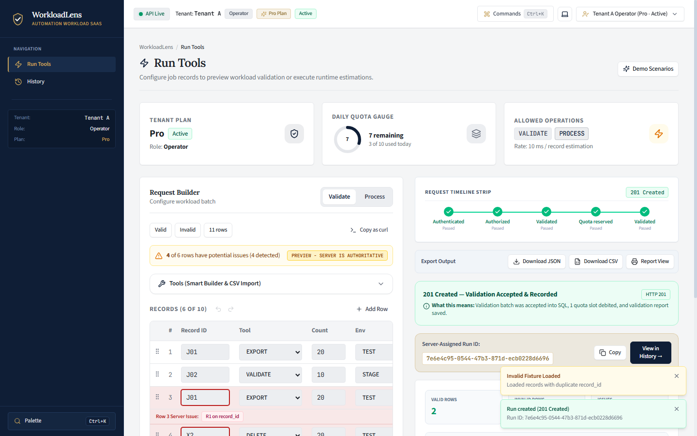
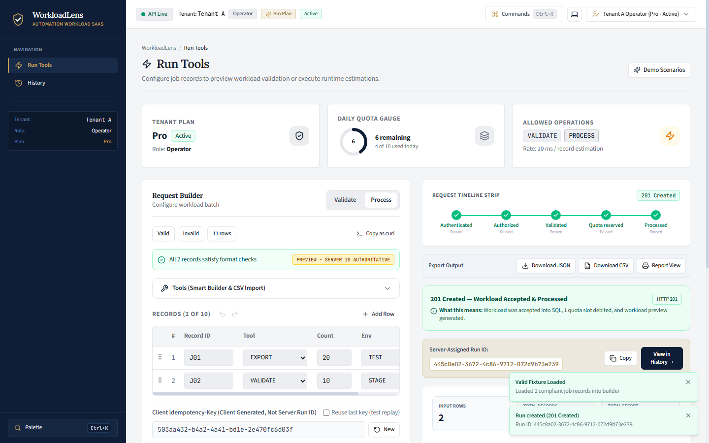
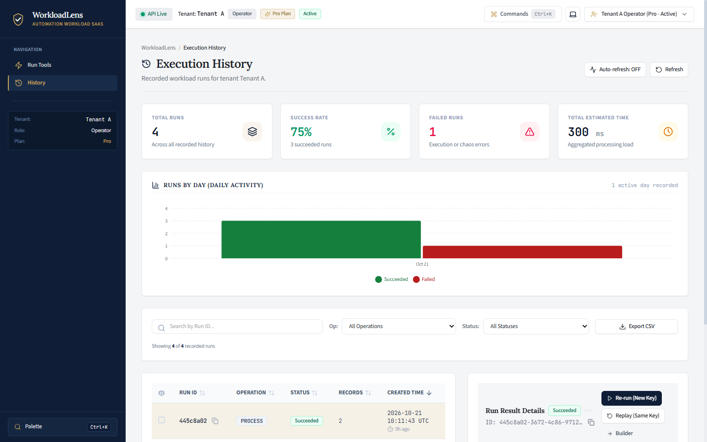
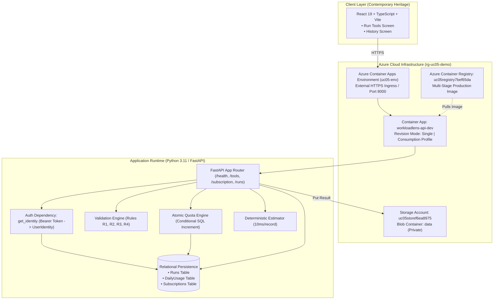

# WorkloadLens — Automation Workload Preview SaaS

[](https://github.com/Sahanaa77/UC-05_automation-workload/actions/workflows/ci.yml)
[](https://github.com/Sahanaa77/UC-05_automation-workload/actions/workflows/build-image.yml)
[](https://www.python.org/downloads/)
[](https://react.dev/)
[](https://tailwindcss.com/)
[](https://www.terraform.io/)

> **UC-05 | Cloud and SaaS Engineering Challenge | Revision 2**  
> **Team:** Code Sapiens  
> **Repository:** [`Sahanaa77/UC-05_automation-workload`](https://github.com/Sahanaa77/UC-05_automation-workload)  
> **Design Direction:** Contemporary Heritage (Restrained Editorial Typography, Deep Navy Foundation, Warm Neutral Surfaces, Antique Gold Accents)

---

## 1. Project Overview

**WorkloadLens** is a multi-tenant Software-as-a-Service (SaaS) application that validates proposed automation jobs and generates estimated workload previews for eligible Pro subscribers. It enforces strict batch validation rules (R1–R4), guarantees cross-tenant isolation, provides atomic daily quota enforcement, and guarantees idempotent execution and history tracking across container cold restarts.

Built by **Team Code Sapiens** for the **UC-05 Automation Workload Preview SaaS** challenge, WorkloadLens operates as an enterprise preflight engine deployed on Microsoft Azure Container Apps, providing full lifecycle automation workload previewing.

---

## 2. Problem Statement and Objectives

Enterprise automation pipelines frequently trigger high-cost downstream jobs without prior structural verification, causing database rollbacks, exhausted API quotas, and unpredictable execution latency.

**WorkloadLens** solves this by acting as a zero-trust preflight gateway:
1. **Validates** proposed automation job batches before execution against four strict rules (R1–R4).
2. **Estimates** processing effort at a deterministic rate of **10 milliseconds per record** for Pro subscribers.
3. **Protects** tenant boundaries, subscription limits, and daily usage quotas under concurrent load.
4. **Guarantees** exactly-once execution semantics through deterministic SHA-256 idempotency fingerprinting.

---

## 3. Key Capabilities and UC-05 Requirements

### Validation Rules (R1–R4)

| Rule ID | Target Field | Requirement & Constraints |
|:---:|---|---|
| **R1** | `record_id` | Nonempty string, 1 to 20 characters, strictly unique within the batch. Case-sensitive. |
| **R2** | `tool` | Allowed tool values: `EXPORT` or `VALIDATE`. |
| **R3** | `record_count` | Integer from 1 through 1000. Booleans (`true`/`false`) and numeric strings (`"20"`) are invalid. |
| **R4** | `environment` | Allowed execution environments: `TEST` or `STAGE`. Production (`PROD`) is prohibited. |

*Notes:* Strings are trimmed before validation. Each invalid row is counted once even if it violates multiple rules. In `process` mode, any invalid row causes immediate rejection with `HTTP 400 Bad Request` and zero quota consumption.

### SaaS Subscription Plans & Permissions

| Feature / Operation | Basic Plan (`tenant-b`) | Pro Plan (`tenant-a`) | Suspended (`tenant-suspended`) |
|---|:---:|:---:|:---:|
| **Validate Operation** | Allowed | Allowed | Denied (`HTTP 403`) |
| **Process Operation** | Denied (`HTTP 403`) | Allowed | Denied (`HTTP 403`) |
| **Daily Quota Limit** | **3 accepted runs / UTC day** | **10 accepted runs / UTC day** | 0 new submissions |
| **Historical Reads (`GET /runs`)** | Allowed | Allowed | Allowed (`HTTP 200`) |
| **Viewer Role Submissions** | Denied (`HTTP 403`) | Denied (`HTTP 403`) | Denied (`HTTP 403`) |

---

## 4. Live Website

[**Open WorkloadLens Web Application**](https://workloadlens-api-dev.ashyglacier-4fc4aa73.centralindia.azurecontainerapps.io/)

The primary user-facing SaaS application deployed as a unified multi-stage container on Azure Container Apps. The web interface provides the two required product screens:
* **Run Tools (`/#/tools`):** Interactive automation workload builder, client and server-side R1–R4 rule validator, Pro workload estimator, and real-time quota gauge.
* **History (`/#/history`):** Chronological log of persisted tenant workloads, terminal state indicators, and complete run result inspections.

---

## 5. Live API

The backend REST API is hosted on the same production Azure Container App instance:

* **Live API Base URL:** [`https://workloadlens-api-dev.ashyglacier-4fc4aa73.centralindia.azurecontainerapps.io`](https://workloadlens-api-dev.ashyglacier-4fc4aa73.centralindia.azurecontainerapps.io)
* **API Health Check:** [`GET /health`](https://workloadlens-api-dev.ashyglacier-4fc4aa73.centralindia.azurecontainerapps.io/health) — Returns `{"status":"ok"}` with zero tenant data exposed.
* **Interactive API Documentation (Swagger / OpenAPI):** [`GET /docs`](https://workloadlens-api-dev.ashyglacier-4fc4aa73.centralindia.azurecontainerapps.io/docs) — Interactive specification for all six standard API routes.

---

## 6. Screenshots

The following authentic screenshots demonstrate the redesigned **Contemporary Heritage** interface captured directly at a consistent desktop viewport of **1440 × 900** using headless Microsoft Edge:

### 1. Run Tools — Clean Initial Screen

*Demonstrates the initial state of the Run Tools screen: Deep Navy architectural header, circular daily quota gauge (10 remaining for Pro), active tenant and role badge context, and the job records builder ready for input.*

---

### 2. Run Tools — Successful Validation Result (`A02`)

*Demonstrates a successful validation submission for the official 2-row compliant fixture (J01, J02): HTTP 201 Created, server-generated Run ID clearly distinguished from the client Idempotency-Key, reporting 2 valid rows, 0 invalid rows, and zero rule issues.*

---

### 3. Run Tools — Validation Issues Breakdown (`A03` / Rules R1–R4)

*Demonstrates validation feedback for the 6-row invalid fixture: reporting 2 valid rows and 4 invalid rows, with structured 1-based row indices and rule violation tags (`R1` duplicate ID, `R2` unsupported DELETE tool, `R3` zero record count, and `R4` unapproved PROD environment).*

---

### 4. Run Tools — Successful Pro Processing Result (`A04`)

*Demonstrates execution of the Pro-tier `process` operation: returns exact estimated execution effort (J01: 200 ms, J02: 100 ms) and summary totals (2 input rows, 30 total records, 300 ms total estimated effort).*

---

### 5. Workload History — Populated Persisted Runs (`A04` / `A07`)

*Demonstrates the History screen displaying real persisted SQL runs for the authenticated tenant: chronological timestamps, distinct operation badges (`validate` vs `process`), server Run IDs, record counts, and terminal statuses (`Succeeded` vs `Failed`).*

---

### 6. Workload History — Run Result Detail Inspection (`A04`)

*Demonstrates detailed result inspection for an accepted run via the `GET /runs/{id}/result` endpoint, displaying per-job execution estimates, input parameters, and storage persistence status.*

---

## 7. System Architecture



---

## 8. Technology Stack

| Domain | Technology | Version | Purpose & Rationale |
|---|---|---|---|
| **Backend Runtime** | Python | 3.11+ / 3.12 | Strongly typed asynchronous backend execution. |
| **Web Framework** | FastAPI | 0.115+ | High-performance asynchronous REST API with automatic OpenAPI validation. |
| **Data Persistence** | SQLAlchemy + SQLite / PostgreSQL | 2.0+ | Relational mapping, ACID transaction boundaries, and conditional atomic upserts. |
| **Data Validation** | Pydantic | v2 | Strict schema parsing and type coercion prevention. |
| **Testing** | Pytest | 8.x | Comprehensive test harness covering unit, integration, and concurrency scenarios. |
| **Frontend Framework** | React | 19.0 | Component-driven user interface with hooks and strict state encapsulation. |
| **Type Safety** | TypeScript | 5.5+ | Full client-side typing across models, API responses, and route definitions. |
| **Bundler & Tooling** | Vite | 6.x | Fast ESM module bundling, Hot Module Replacement, and optimized production builds. |
| **Styling** | Tailwind CSS | v4.0 | Utility-first styling implementing Contemporary Heritage design tokens. |
| **UI Icons** | Lucide React | 1.x | Lightweight, accessible iconography. |
| **Visual Charts** | Recharts | 2.x | Responsive SVG metric and quota visualizations. |
| **Cloud Hosting** | Azure Container Apps | Linux / Consumption | Serverless container runtime with dynamic scaling and HTTPS ingress. |
| **Container Registry** | Azure Container Registry (ACR) | Basic SKU | Secure private container image distribution. |
| **Blob Storage** | Azure Blob Storage | Hot Tier | Cloud-persisted run execution payloads and simulation artifacts. |
| **IaC** | Terraform | 1.6+ | Declarative, idempotent provisioning of the two required Azure cloud resources. |

---

## 9. Setup and Execution Instructions

### Prerequisites
* **Python:** 3.11 or higher
* **Node.js:** 20 or higher
* **Terraform:** 1.6+ (for infrastructure verification)

### Quick Start
```bash
# 1. Clone repository
git clone https://github.com/Sahanaa77/UC-05_automation-workload.git
cd UC-05_automation-workload

# 2. Setup backend virtual environment
python -m venv .venv
source .venv/bin/activate  # On Windows: .venv\Scripts\activate
pip install -e "backend[dev]"

# 3. Setup frontend dependencies
cd frontend
npm install
cd ..

# 4. Start local development server (Unified SPA + API)
python -m uvicorn app.main:app --host 127.0.0.1 --port 8000 --app-dir backend
```

---

## 10. API Endpoints and Expected Behavior

All protected endpoints require an `Authorization: Bearer <token>` header. Tenant identifiers are **never** accepted in query parameters or request bodies.

### 1. `GET /health` (Public)
* **Summary:** Health check route. Exposes no tenant data.
* **Response (200 OK):** `{"status": "ok"}`

### 2. `GET /tools` (Authenticated)
* **Summary:** Lists available tools and permitted operations for the caller's plan.
* **Response (200 OK):**
```json
{
  "tools": [
    {"name": "EXPORT", "description": "Automation export workload generator", "environments": ["TEST", "STAGE"]},
    {"name": "VALIDATE", "description": "Automation validation and verification suite", "environments": ["TEST", "STAGE"]}
  ],
  "allowed_operations": ["validate", "process"],
  "rate_ms_per_record": 10
}
```

### 3. `GET /subscription` (Authenticated)
* **Summary:** Returns tenant subscription status, tier, and remaining daily quota.
* **Response (200 OK):**
```json
{
  "tenant_id": "tenant-a",
  "plan": "Pro",
  "status": "Active",
  "daily_quota": 10,
  "used_today": 3,
  "remaining_today": 7
}
```

### 4. `POST /runs` (Authenticated, Idempotent)
* **Required Header:** `Idempotency-Key: <unique-client-key>`
* **Request Body:**
```json
{
  "operation": "process",
  "records": [
    {"record_id": "J01", "tool": "EXPORT", "record_count": 20, "environment": "TEST"},
    {"record_id": "J02", "tool": "VALIDATE", "record_count": 10, "environment": "STAGE"}
  ]
}
```
* **Response (201 Created):**
```json
{
  "run_id": "8e7faa88-c8d7-4ffd-b0a6-8caa3961e458",
  "status": "Succeeded",
  "operation": "process",
  "result": {
    "summary": {"input_rows": 2, "total_records": 30, "total_estimated_ms": 300},
    "rows": [{"record_id": "J01", "estimated_ms": 200}, {"record_id": "J02", "estimated_ms": 100}]
  },
  "error": null,
  "created_at": "2026-10-21T12:30:36.400307",
  "finished_at": "2026-10-21T12:30:36.405342"
}
```

### 5. `GET /runs` (Authenticated)
* **Summary:** Returns historical runs belonging strictly to the authenticated tenant.
* **Response (200 OK):** List of persisted run objects.

### 6. `GET /runs/{id}/result` (Authenticated)
* **Summary:** Retrieves result for a run. Returns `HTTP 404 Not Found` for other tenants' run IDs.

---

## 11. Testing and Verification

### 1. Backend Test Suite (63 Tests)
```bash
python -m pytest backend/tests/ -v
```
*Executes all 63 acceptance tests covering authentication, tenant isolation, concurrency race conditions, idempotency replays, and R1–R4 rule validation.*

### 2. Frontend Production Build
```bash
npm run build --prefix frontend
```
*Performs TypeScript type-checking (`tsc -b`) and asset bundling via Vite, outputting optimized static assets to `frontend/dist/`.*

### 3. Terraform Format & Validation
```bash
terraform -chdir=infra fmt -check
terraform -chdir=infra validate
```
*Verifies infrastructure syntax and provider compatibility without errors.*

---

## 12. Acceptance Criteria and Evidence

A01–A11 automated and live cloud checks are fully verified (**PASS**); A12 is documented and prepared for independent teammate evaluation:

| Check | Description | Verification Scope | Status |
|:---:|---|---|:---:|
| **A01** | Public `/health` 200, exactly 2 Terraform resources, 0 repeat drift | Live Cloud + Terraform | **PASS** |
| **A02** | Valid 2-row fixture (J01, J02) produces 2 valid rows, 0 invalid rows | Live Cloud + Pytest | **PASS** |
| **A03** | Invalid 6-row fixture confirms all four rules R1, R2, R3, and R4 | Live Cloud + Pytest | **PASS** |
| **A04** | Pro processing produces exact outputs (J01=200ms, J02=100ms, total=300ms) | Live Cloud + Pytest | **PASS** |
| **A05** | Invalid process, malformed payloads, and 11 rows return 400 with 0 quota debit | Live Cloud + Pytest | **PASS** |
| **A06** | 401 on unauthenticated; Viewer submit & Basic process return 403 | Live Cloud + Pytest | **PASS** |
| **A07** | Strict cross-tenant isolation; cross-tenant reads return 404 | Live Cloud + Pytest | **PASS** |
| **A08** | Basic accepts 3 runs/day, rejects 4th with 429; atomic concurrency guard | Local Pytest Concurrency | **PASS** |
| **A09** | Idempotency replay returns 200 with 0 quota debit; changed payload returns 409 | Live Cloud + Pytest | **PASS** |
| **A10** | Suspended subscription rejects new runs (403); historical reads permitted | Live Cloud + Pytest | **PASS** |
| **A11** | Processing failure hook sets Failed status, consumes 1 slot, replay returns Failed | Local Pytest + Cloud | **PASS** |
| **A12** | Fresh-session independent evaluation via `skills/automation-preview/SKILL.md` | Independent Session Replay (Intended Peer Verifier: Poojhaa K) | **READY FOR PEER VERIFICATION** |

See [`docs/architecture/acceptance-matrix.md`](docs/architecture/acceptance-matrix.md) for complete command transcripts and outputs.

---

## 13. References and Design Rationale

WorkloadLens draws upon established engineering guidance in software architecture, multitenant cloud design, formal HTTP semantics, and infrastructure-as-code standards. Core architectural mechanisms—including pure-function batch rule validation, atomic quota reservations via conditional SQL updates, strict cryptographically derived tenant boundaries, application-level idempotency replays, and bounded Terraform infrastructure—are grounded in verified industry references:

* **Martin Fowler et al., *Patterns of Enterprise Application Architecture* (2002):** Separates pure validation logic from state mutations; informs the Unit of Work and Service Layer isolation.
* **Martin Kleppmann, *Designing Data-Intensive Applications* (2017):** Single-statement conditional SQL updates (`UPDATE ... WHERE used_today < daily_quota`) ensuring atomic quota reservation without race conditions.
* **Microsoft Azure Architecture Center, *SaaS and Multitenant Solution Architecture*:** Cryptographic tenant boundary enforcement derived exclusively from verified JWT identity.
* **IETF, *RFC 9110: HTTP Semantics* (Section 9.2.2):** Safe and idempotent request-replay semantics via client-supplied `Idempotency-Key` headers.
* **HashiCorp, *Terraform Recommended Practices*:** Strict declarative infrastructure bounded to exactly two cloud resources.

For complete citations, conceptual summaries, verified application mappings, and explicit project boundaries, see [`docs/architecture/references.md`](docs/architecture/references.md).

---

## 14. Team Code Sapiens

*WorkloadLens — UC-05 Automation Workload Preview SaaS*

WorkloadLens was engineered, tested, verified, and deployed by **Team Code Sapiens** for the **UC-05 Automation Workload Preview SaaS** challenge (Cloud & SaaS Engineering Challenges, Revision 2).

### Team and Contributions

#### **Poojhaa K**
*Team Lead & Technical Coordination*  
Directs overall project delivery, milestone governance, team synchronization, and architectural alignment with UC-05 specifications.
* **Project Governance & Delivery:** Coordinates milestones, task delegation, review cadences, and cross-functional synchronization between engineering, quality assurance, and deployment streams.
* **Specification & Architecture Alignment:** Oversees compliance with UC-05 challenge standards, including R1–R4 batch validation constraints, tenant isolation boundaries, and daily quota limits.
* **Quality & Integration Review:** Coordinates delivery reviews and serves as designated peer verifier for acceptance check A12 independent fresh-session replay (*pending independent execution*).
* **GitHub:** Confirmation pending (*supplied handle `Govindharaju_1951` returned HTTP 404; pending team confirmation*).

---

#### **Rohita M**
*Documentation, QA & Deployment Lead*  
Leads technical architecture documentation, automated test suite engineering, cloud CI/CD pipeline automation, and Azure release verification.
* **Technical Documentation:** Prepared and refined comprehensive architecture explanations ([`high-level-architecture.md`](docs/architecture/high-level-architecture.md), [`sequence-diagrams.md`](docs/architecture/sequence-diagrams.md), [`data-model.md`](docs/architecture/data-model.md), [`references.md`](docs/architecture/references.md)), operational runbooks ([`RUNBOOK.md`](docs/RUNBOOK.md)), and repository guides.
* **Testing and Quality Assurance:** Contributed to testing and verification, expanding test suites (63 passing tests across unit, boundary, concurrency race condition guards, and failure hooks), and auditing A01–A11 acceptance compliance.
* **Deployment and Release Verification:** Developed automated multi-stage container workflows (`.github/workflows/ci.yml`, `build-image.yml`), verified Azure Container Registry publication, performed live cloud smoke tests, and refined the Contemporary Heritage interface.
* **Acceptance Evidence:** Documented project verification and structured evidence used to demonstrate compliance with UC-05 requirements ([`acceptance-matrix.md`](docs/architecture/acceptance-matrix.md), [`evidence/ACCEPTANCE_EVIDENCE.md`](evidence/ACCEPTANCE_EVIDENCE.md)).
* **GitHub:** Confirmation pending (*profile URL to be confirmed by team member; git author `rohitam256@gmail.com`*).

---

#### **Sahana Shree VS**
*Software Engineering & Application Development*  
Leads core application development, implementing full-stack business logic, validation rules, relational data persistence, and interactive frontend interfaces.
* **Backend Architecture & APIs:** Implemented core FastAPI services, JWT authentication middleware, tenant-isolated request routing, database schema models (`Runs`, `DailyUsage`, `Subscriptions`), and Azure Blob Storage persistence.
* **Business Logic & Validation:** Engineered pure-function R1–R4 batch validation rules, deterministic Pro processing effort estimation (10 ms/record), and atomic conditional SQL quota reservation mechanisms.
* **Frontend Implementation:** Built the single-page application interface in React 19, TypeScript, and Vite, including the interactive workload builder ([`RunTools.tsx`](frontend/src/pages/RunTools.tsx)) and audit history view ([`WorkloadHistory.tsx`](frontend/src/pages/WorkloadHistory.tsx)).
* **Repository & Integration Management:** Managed canonical repository setup, branching workflows (`main`, `uc05-build`), code reviews, and pull request integrations (PRs #1–#7).
* **GitHub:** [Sahanaa77](https://github.com/Sahanaa77) *(verified profile)*

---

### Collaborative Acknowledgement
Team Code Sapiens collaboratively developed WorkloadLens to demonstrate production-grade cloud SaaS engineering, resilient multitenancy, robust concurrency controls, and high-fidelity user experience for automated workload validation.

---

## 15. Technical Documentation Sitemap

* [`docs/architecture/high-level-architecture.md`](docs/architecture/high-level-architecture.md): Complete cloud and application architectural overview.
* [`docs/architecture/sequence-diagrams.md`](docs/architecture/sequence-diagrams.md): Six Mermaid sequence diagrams for all key operational workflows.
* [`docs/architecture/data-model.md`](docs/architecture/data-model.md): Detailed SQL schema, constraints, and ER diagram.
* [`docs/architecture/acceptance-matrix.md`](docs/architecture/acceptance-matrix.md): Traceable A01–A12 compliance audit with evidence links.
* [`docs/architecture/references.md`](docs/architecture/references.md): Industry references, design rationale, and project scope boundaries.
* [`docs/RUNBOOK.md`](docs/RUNBOOK.md): Operational runbook and deployment troubleshooting.
* [`docs/UC05_AUDIT_REPORT.md`](docs/UC05_AUDIT_REPORT.md): Acceptance audit report and teammate replay checklist.

---

## 16. AI Assistance Disclosure

Portions of code formatting, test harness assertions, technical diagrams, and documentation were assisted by Google DeepMind Antigravity AI pair programming tools. All business logic, tenant isolation constraints, quota race condition handling, and acceptance verifications have been independently reviewed, tested, and validated by the team against the official UC-05 specification.
