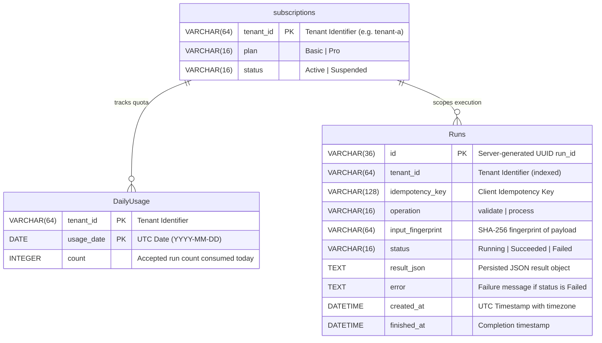

# WorkloadLens UC-05 — Data Model & Schema Specification

> **Specification Reference:** SQLAlchemy Models (`backend/app/models.py`) & Idempotent SQL Migrations (`migrations/001_runs_dailyusage.sql`)

---

## 1. Entity-Relationship Diagram



---

## 2. Table Schemas & Constraints

### 2.1 Table: `Runs`
Persists accepted workloads, execution state, output summaries, and terminal statuses across restarts.

| Column | Data Type | Nullable | Constraints & Description |
|---|---|---|---|
| `id` | `VARCHAR(36)` | NO | **Primary Key** — Canonical server-generated UUID `run_id`. |
| `tenant_id` | `VARCHAR(64)` | NO | Indexed tenant identifier. Strict boundary for tenant isolation. |
| `idempotency_key` | `VARCHAR(128)` | NO | Client-supplied key. Replay identifier. |
| `operation` | `VARCHAR(16)` | NO | Allowed operations: `"validate"` or `"process"`. |
| `input_fingerprint` | `VARCHAR(64)` | NO | SHA-256 digest of canonicalized JSON `(operation, records)`. |
| `status` | `VARCHAR(16)` | NO | Terminal state: `"Running"`, `"Succeeded"`, or `"Failed"`. |
| `result_json` | `TEXT` | YES | Persisted JSON result string containing validation issues or process estimates. |
| `error` | `TEXT` | YES | Recorded failure reason when status is `"Failed"`. |
| `created_at` | `DATETIME` | NO | UTC creation timestamp. |
| `finished_at` | `DATETIME` | YES | UTC completion timestamp. |

#### Constraints & Indexes
* **Unique Constraint (`uq_Runs_tenant_idempotency_key`):** `UNIQUE (tenant_id, idempotency_key)`. Guarantees exactly-once processing per tenant key.
* **Compound Index (`ix_Runs_tenant_created`):** `(tenant_id, created_at DESC)`. Optimizes `GET /runs` chronological retrieval under high tenant volume.

---

### 2.2 Table: `DailyUsage`
Provides atomic daily quota tracking per tenant per UTC day.

| Column | Data Type | Nullable | Constraints & Description |
|---|---|---|---|
| `tenant_id` | `VARCHAR(64)` | NO | **Primary Key (Composite 1/2)** — Tenant identifier. |
| `usage_date` | `DATE` | NO | **Primary Key (Composite 2/2)** — UTC date (`YYYY-MM-DD`). |
| `count` | `INTEGER` | NO | Number of accepted unique runs consumed today. Default: `0`. |

#### Atomic Quota Reservation Logic
To prevent race conditions during high-concurrency requests competing for the final slot, quota is debited via a single atomic conditional SQL operation:
```sql
UPDATE "DailyUsage"
SET count = count + 1
WHERE tenant_id = :tenant_id
  AND usage_date = :today
  AND count < :limit;
```
* If `rowcount == 1`: The quota slot was successfully acquired.
* If `rowcount == 0`: The daily limit was reached; transaction rolls back and returns `HTTP 429 Too Many Requests`.

---

### 2.3 Table: `subscriptions`
Stores subscription tiers, plan allowances, and account states.

| Column | Data Type | Nullable | Constraints & Description |
|---|---|---|---|
| `tenant_id` | `VARCHAR(64)` | NO | **Primary Key** — Unique tenant slug (`tenant-a`, `tenant-b`, `tenant-suspended`). |
| `plan` | `VARCHAR(16)` | NO | `"Basic"` (3 runs/day, validate only) or `"Pro"` (10 runs/day, validate & process). |
| `status` | `VARCHAR(16)` | NO | `"Active"` or `"Suspended"`. Suspended tenants cannot submit new runs (`HTTP 403`). |

---

## 3. Seed Identities & Test Data

| Tenant ID | Initial Plan | Initial Status | Evaluation Token | Authorized Roles |
|---|---|---|---|---|
| `tenant-a` | **Pro** | `Active` | `token-tenant-a-operator` | Operator (full access), Viewer |
| `tenant-b` | **Basic** | `Active` | `token-tenant-b-operator` | Operator (validate only), Viewer |
| `tenant-suspended` | **Pro** | `Suspended` | `token-tenant-suspended-operator` | Operator (reads only), Viewer |
