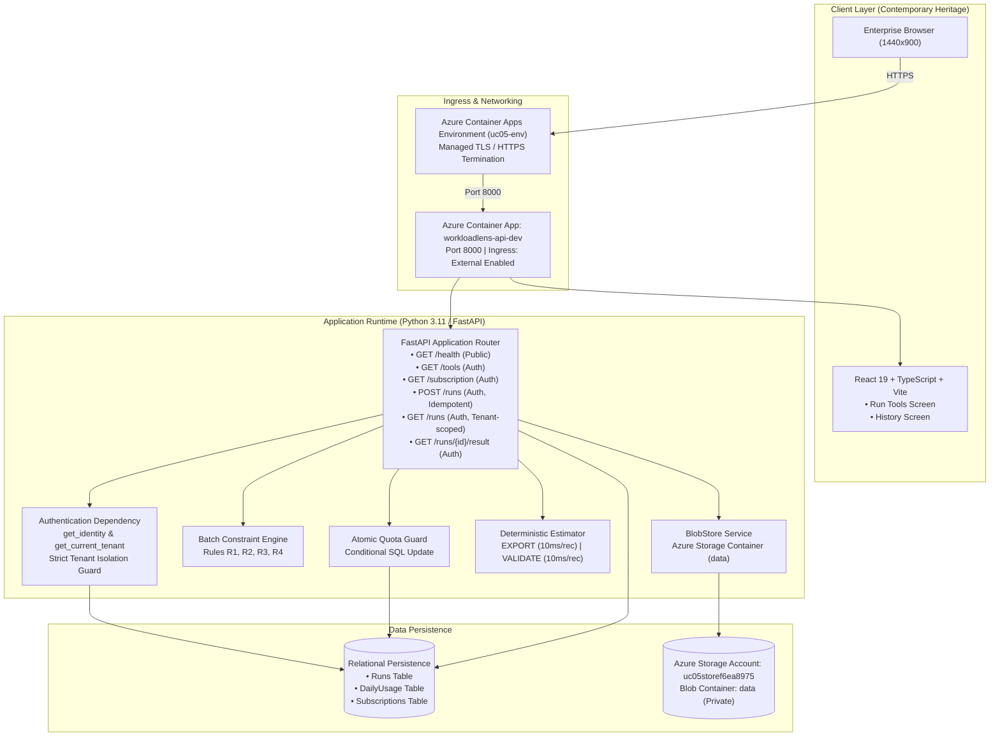

# WorkloadLens UC-05 — High-Level System Architecture

> **Product:** WorkloadLens (Automation Workload Preview SaaS)  
> **Team:** Code Sapiens  
> **Architecture Revision:** 2.0 (Contemporary Heritage Release)  
> **Target Cloud:** Azure Container Apps (Central India, Consumption Profile)  
> **Primary Endpoint:** `https://workloadlens-api-dev.ashyglacier-4fc4aa73.centralindia.azurecontainerapps.io`

---

## 1. Executive Summary & Purpose

**WorkloadLens** is a multi-tenant Software-as-a-Service (SaaS) platform designed for previewing, validating, and estimating automation workloads before execution. It enforces strict structural and semantic batch constraints (rules R1–R4), guarantees cross-tenant isolation, protects daily quota quotas atomically, and maintains idempotent lifecycle tracking across cold restarts.

The platform is designed following the **Contemporary Heritage** aesthetic: a reliable, disciplined enterprise interface with warm neutral surfaces, deep navy structural foundations (`#0F1E36`), and sparing antique-gold accents (`#C5A059`).

---

## 2. System Architecture Diagram

---

## 3. Frontend-to-Backend Request Flow

1. **Client Request:** The user interacts with the React 19 application via `RunTools` or `WorkloadHistory`.
2. **Identity Propagation:** Requests attach a `Authorization: Bearer <token>` header. Tenant identifiers are **never** accepted from query parameters, request bodies, or custom headers. Any request with `X-Tenant-Override` or `tenant_id` in the payload is rejected with `HTTP 400 Bad Request`.
3. **Pipeline Lifecycle:**
   - **Authentication:** `get_identity` validates the token and resolves `(user_id, tenant_id, role)`.
   - **Authorization:** `get_current_tenant` verifies the tenant subscription status (`Active` vs `Suspended`) and plan (`Basic` vs `Pro`). Viewers are prohibited from submitting runs (`HTTP 403`). Suspended tenants are prohibited from submitting new runs (`HTTP 403`), but may read historical records (`HTTP 200`).
   - **Structural Validation:** Body format, field boundaries, and record counts (1–10 records) are verified.
   - **Idempotency Fingerprint:** A deterministic SHA-256 fingerprint is calculated over `operation + records`.
   - **Idempotency Check:** If `(tenant_id, idempotency_key)` exists:
     - Matching fingerprint: Returns original run with `HTTP 200 OK` (0 quota debited).
     - Mismatched fingerprint: Returns `HTTP 409 Conflict`.
     - Run currently `Running`: Returns `HTTP 409 RUN_IN_PROGRESS`.
   - **Atomic Quota Reservation:** Runs a conditional SQL increment (`UPDATE daily_usage SET count = count + 1 WHERE count < limit`). If 0 rows updated, returns `HTTP 429 Too Many Requests`.
   - **Execution & Persistence:** Validates or processes the batch, commits terminal status (`Succeeded` or `Failed`), writes results to BlobStore, and returns `HTTP 201 Created`.

---

## 4. Security & Tenant Isolation Model

* **Verified Identity Context:** Tenant assignment is strictly derived from the verified Bearer token.
* **Strict Parameter Isolation:** Query string `?tenant_id=...` or headers like `X-Tenant-ID` immediately trigger `HTTP 400 Bad Request`.
* **Database Isolation:** All queries filter on `WHERE tenant_id = :tenant_id`. Tenant B cannot view or retrieve any run or result belonging to Tenant A (returns `HTTP 404 Not Found`).
* **Secrets Management:** Sensitive variables (`DATABASE_URL`, `acr-password`) are injected via Container App secret references and never printed in logs or committed to VCS.

---

## 5. Terraform Scope vs Organizer Prerequisites

| Component | Responsibility | Management Scope |
|---|---|---|
| **Resource Group (`rg-uc05-demo`)** | Organizer-provided | Pre-existing dependency; referenced via data source |
| **Container Apps Environment (`uc05-env`)** | Organizer-provided | Pre-existing dependency; referenced by resource ID |
| **Azure Container Registry (`uc05registry7bef65da`)** | Organizer-provided | Pre-existing image publishing target |
| **Storage Account (`uc05storef6ea8975`)** | Organizer-provided | Pre-existing storage account |
| **Container App (`workloadlens-api-dev`)** | **Team-managed (Terraform)** | Defined in `infra/main.tf` (`azurerm_container_app.api`) |
| **Blob Container (`data`)** | **Team-managed (Terraform)** | Defined in `infra/main.tf` (`azurerm_storage_container.data`) |

---

## 6. CI/CD & Image Publishing Workflow

1. **Commit & Push:** Pushes to `main` trigger GitHub Actions workflows in `.github/workflows/`.
2. **Backend CI (`ci.yml`):** Runs `pytest backend/tests/` across Python 3.12, validating all 63 acceptance tests.
3. **Frontend CI (`ci.yml`):** Runs `npm run build` (`tsc -b && vite build`) verifying TypeScript types and assets.
4. **Terraform CI (`ci.yml`):** Runs `terraform fmt -check` and `terraform validate`.
5. **Image Build & Publishing (`build-image.yml`):** Executes multi-stage Docker build, bundles the static frontend and Python backend, and pushes image tags `<commit-sha>` and `latest` to ACR.
