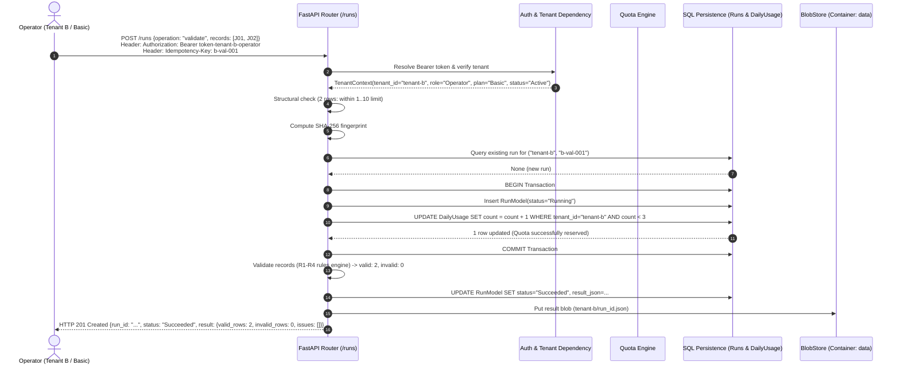
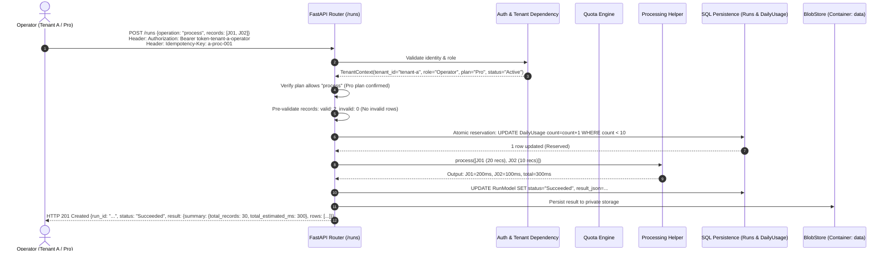
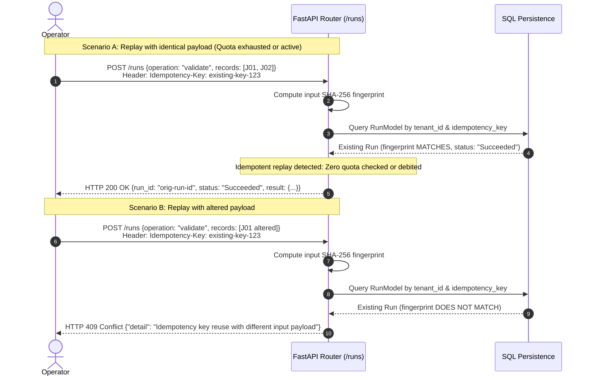
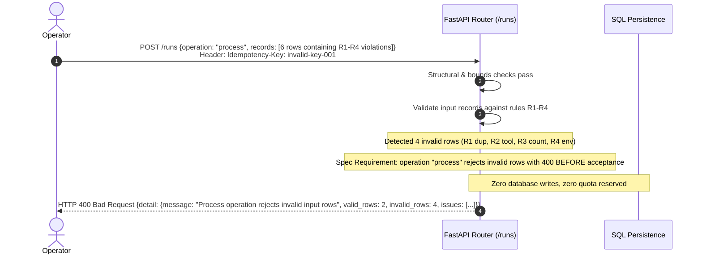
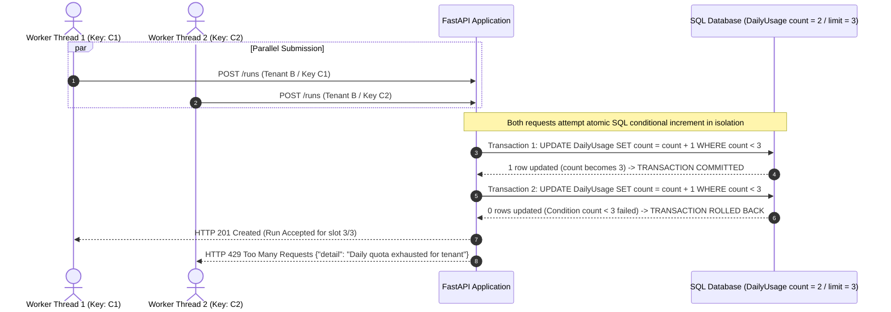
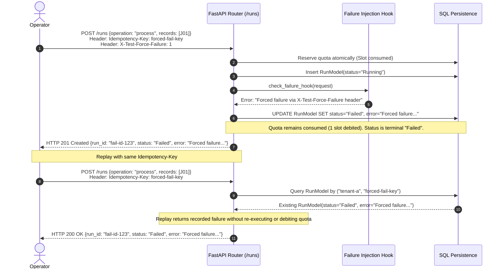

# WorkloadLens UC-05 — Lifecycle Sequence Diagrams

> **Specification Reference:** Official UC-05 Revision 2 Requirements  
> **Aesthetic Reference:** Contemporary Heritage Architecture Series

---

## 1. Successful Basic-Plan Validation (`A02`)

---

## 2. Successful Pro-Plan Processing (`A04`)

---

## 3. Idempotent Replay Lifecycle (`A09`)

---

## 4. Invalid Request Rejected Before Quota Acceptance (`A03` / `A05`)

---

## 5. Concurrent Requests Competing for the Final Quota Slot (`A08`)

---

## 6. Accepted Processing Failure and Replay (`A11`)

